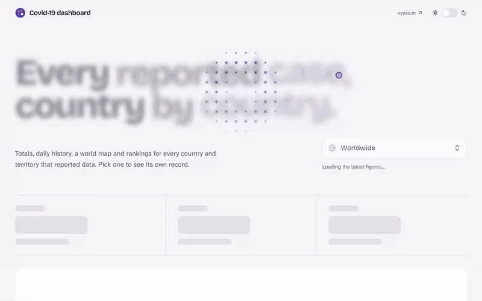

# COVID-19 Dashboard

COVID-19 cases, recoveries and deaths for every country, with daily history, a world map and rankings.
Works in light and dark mode, on desktop and mobile.



**Live site:** [covid19-dashboardjs.netlify.app](https://covid19-dashboardjs.netlify.app/)
**Made by** [Vaibhav](https://vvyas.in)

## Features

- **Headline totals** for cases, recoveries and deaths, worldwide or for one country, with per-million rates.
  The digits roll to the new values when you change country.
- **Country search** with flags, plus a one-click way back to worldwide figures.
- **Daily chart** of new cases or deaths as a 7-day average, with the peak day marked and a tooltip for any date.
- **World map** shaded by cases per million, deaths per million or total cases. Point at a country to see its
  figure, click it to select it.
- **Country ranking** sorted by the same metric as the map.
- **Light and dark mode** that follows your system setting and remembers your choice.
- **Accessible:** keyboard navigation, visible focus, screen-reader labels, and reduced motion respected.

## Getting started

### Requirements

- [Node.js](https://nodejs.org) **20.19 or later** (22 LTS recommended). Check with `node -v`.
- npm, which comes with Node.

### Install and run

In the project folder:

```bash
npm install
npm start
```

Then open the address shown in the terminal (usually http://localhost:5173). The page reloads as you edit.

### Scripts

| Command           | What it does                                     |
| ----------------- | ------------------------------------------------ |
| `npm start`       | Starts the dev server (same as `npm run dev`)    |
| `npm run build`   | Builds the production site into `dist/`          |
| `npm run preview` | Serves the production build locally, to check it |

## Deploying

The site is static: build it and serve the `dist/` folder.

**Netlify** (used for the live site): connect the repository and deploy. `netlify.toml` already sets the build
command (`npm run build`), the publish folder (`dist`) and Node 22, so no dashboard settings are needed.

**Vercel, Cloudflare Pages or any static host serving from the domain root:** set the build command to `npm run build`, the output
folder to `dist`, and Node to version 22.

No environment variables or API keys are needed.

## Customising

| To change                       | Edit                                                         |
| ------------------------------- | ------------------------------------------------------------ |
| Colours for light and dark mode | The CSS variables at the top of `src/index.css`              |
| Dot-grid colours in the hero    | `src/lib/theme.js` (keep in sync with `src/index.css`)       |
| Fonts                           | The `@import` lines and `--font-*` values in `src/index.css` |
| Portfolio link                  | `src/lib/links.js`                                           |
| Map and ranking metrics         | `MAP_METRICS` in `src/lib/metrics.js`                        |
| Headline and intro text         | `src/Components/Hero.jsx`                                    |

## Project structure

```
├── index.html               page shell; sets the theme before first paint
├── netlify.toml             Netlify build settings
├── public/favicon.svg
├── docs/demo.gif            the recording at the top of this file
└── src/
    ├── index.jsx            entry point
    ├── index.css            Tailwind setup, colour tokens and fonts
    ├── App.jsx              page layout and the selected country
    ├── Components/          the dashboard sections
    │   ├── Hero.jsx             headline, intro and country search
    │   ├── CountryPicker.jsx    searchable country list
    │   ├── StatStrip.jsx        cases, recovered and deaths totals
    │   ├── TrendChart.jsx       daily chart
    │   ├── WorldSection.jsx     map and ranking with their shared metric
    │   ├── WorldMap.jsx         the choropleth map
    │   ├── CountryRanking.jsx   ranked country list
    │   └── …                    header, footer, theme toggle, shared panel and segmented control
    ├── hooks/
    │   ├── useCovidData.js      loads totals, the country list and daily history
    │   └── useTheme.js          light/dark theme
    ├── lib/                     API client, number formatting, chart and map helpers
    └── reactbits/               React Bits components, kept as published
```

The chart and the map load separately from the rest of the page, so the first screen appears faster.

## About the data

All figures come from the free [disease.sh](https://disease.sh) API.

- **Totals** (cases, recoveries, deaths, per-million rates) come from Worldometers.
- **Daily history** comes from Johns Hopkins University CSSE, which **stopped collecting data on 10 March 2023**,
  so the chart ends there.
- **Recoveries** are no longer reported by some countries, India among them. The dashboard shows "Not reported" for
  those rather than 0, and leaves out their active-case count, since that is worked out from recoveries.
- **Daily history isn't available** for some smaller countries and territories; their chart says so, and their
  totals still show.
- **Cruise ships** (Diamond Princess, MS Zaandam) are listed by the API but aren't countries, so they're left out.

If the API doesn't respond, the page says so and offers a retry button.

## Tech

- [React 19](https://react.dev) and [Vite](https://vite.dev)
- [Tailwind CSS 4](https://tailwindcss.com)
- [React Bits](https://reactbits.dev): BlurText (headline), Counter (rolling totals), DotGrid (hero background),
  RubberSegment (metric toggles) and SquishSwitch (theme toggle)
- [Recharts](https://recharts.org) for the chart
- [d3-geo](https://d3js.org/d3-geo), [topojson-client](https://github.com/topojson/topojson-client) and
  [world-atlas](https://github.com/topojson/world-atlas) for the map
- [Headless UI](https://headlessui.com) for the country search
- [Lucide](https://lucide.dev) icons
- Fonts: [Bricolage Grotesque](https://fonts.google.com/specimen/Bricolage+Grotesque) for headings and
  [Atkinson Hyperlegible Next](https://www.brailleinstitute.org/freefont/) for body text, self-hosted through
  Fontsource

## Design

The colours come from the microscope. Light mode uses the stains of histology slides: hematoxylin violet for cases,
methyl green for recoveries and eosin pink for deaths. Dark mode switches to the glowing dyes of fluorescence
microscopy: DAPI blue, GFP green and Texas red. The dot grid behind the headline is a nod to the counting grid on a
lab slide.

## Troubleshooting

- **`npm install` or `npm start` fails with an engine or syntax error:** your Node version is too old. Install
  Node 22 LTS and try again.
- **"The figures didn't load":** the disease.sh API didn't respond. Open
  https://disease.sh/v3/covid-19/all in your browser; if it shows JSON, retry from the page.
- **Port 5173 is in use:** Vite picks the next free port automatically and prints it in the terminal.

## Credits and licence

- Data: [disease.sh](https://disease.sh), Worldometers and Johns Hopkins University CSSE.
- The components in `src/reactbits/` are from [React Bits](https://reactbits.dev) by David Haz, under MIT +
  Commons Clause, which allows use in projects like this one but not reselling the components themselves.
